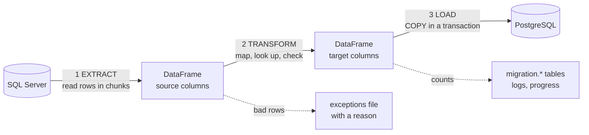
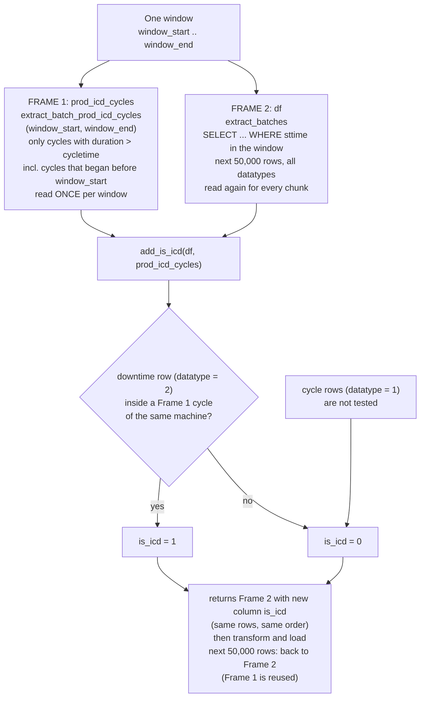
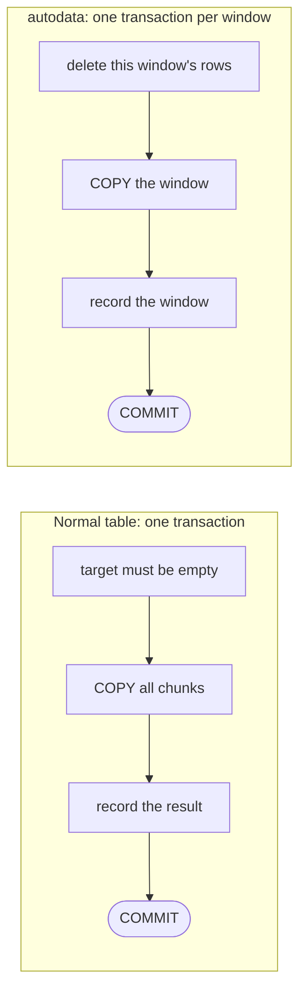

# TPM migration: SQL Server → PostgreSQL

Copies the 25 `master_data` tables and `production_core.autodata` from SQL Server (`TPM_PGSQL`) to PostgreSQL.
One YAML file per table (`config/mappings/`) says where each target column comes from.
It is a plain copy with column mapping and lookups. No business changes.

> Anything that changes a production system needs testing and your normal change-control review first.
> Always run a rehearsal (the default) before a real migration.

*Diagrams are Mermaid. They show on GitHub and in the VS Code markdown preview.*

---

## 1. The pipeline in one picture



Every table goes through the same three steps. Tables run in dependency order (parents before children).
A **rehearsal** does everything inside one transaction and rolls it back. A **real** run keeps the data.

---

## 2. Extract

SQL Server rows are read in chunks of 50,000 into a DataFrame. Only the columns the mapping uses are read.

Small tables are read in one go. The big table, `autodata`, is read in **windows of one logical month** (default).
A *logical day* starts when the first shift starts (for example 06:00), taken from `utility.get_logical_day`.
Fixed windows of N days (`--days N`, 15 in the mapping) are also possible.

**Terms used in this file:** a **window** is one time range of `autodata` (loaded in one transaction).
A **chunk** is the next 50,000 rows read from inside a window.

```
 window 1: 2026-10-01 06:00  ->  2026-11-01 06:00
 window 2: 2026-11-01 06:00  ->  2026-12-01 06:00      each window starts where the last one ended
```

* A row belongs to the window that contains its start time (`sttime`). No gaps, no overlaps.
  Rows with `sttime` NULL get one extra window, so no row is lost.
* The run stops if the windows miss any row (their total must equal the table's row count).

---

## 3. Transform

Each DataFrame goes through the rules of its YAML file: `copy`, `cast`, `trim`, `coalesce`, `map`, `lookup`, and so on.

* **Lookup:** a business id from the source (for example a machine code) is replaced by the target's `iot_id`,
  using the parent table already loaded in PostgreSQL.
* **Checks:** the value fits the target type, NOT NULL columns have a value, no duplicate key, the parent was found.
* A row that fails a check is **not dropped silently**. It goes to `reports/<table>_exceptions.csv` with a reason.
* After every table: `rows read = rows loaded + rows in the exceptions file`, or the run stops.

### How `is_icd` is solved for autodata

`autodata` has two kinds of rows: **cycles** (`datatype = 1`, a part being machined) and **downtimes** (`datatype = 2`).
A downtime is an **ICD** (in-cycle downtime) when it happens *inside* a cycle that ran longer than its own `cycletime`.

> **Rule:** downtime is ICD when a cycle of the **same machine**, with `duration > cycletime`,
> **starts before** the downtime starts and **ends after** the downtime ends.

SQL Server did this with a slow check per row. Here it is done in Polars, with **two frames** per window.
`prod_icd_cycles` means *production cycles that can hold an ICD*: the cycles that ran longer than their `cycletime`.

| Frame | What it holds | How it is read | How often |
|---|---|---|---|
| **Frame 1** `prod_icd_cycles` | Only the candidate cycles: `datatype = 1` and `duration > cycletime`. Columns `mc, sttime, ndtime`. Includes cycles that started *before* the window start and run into it. | `extract_batch_prod_icd_cycles(window_start, window_end)`: one query per machine, range `[window_start - lookback, window_end)` | **Once per window** |
| **Frame 2** `df` | The real rows to migrate (all `datatype`s): one chunk of up to **50,000 rows** of the window | `extract_batches`: `SELECT ... WHERE sttime >= window_start AND sttime < window_end`, read with `fetchmany(50000)` | **Repeated** until the window is finished |

`lookback` is the longest cycle that qualifies (measured once per run, `compute_icd_lookback`). No cycle that contains a
downtime can start earlier than `window_start - lookback`, so Frame 1 stays small but is still exact.

**Steps for one window:**

1. Read **Frame 1** (`prod_icd_cycles`) once.
2. Read the next chunk of up to 50,000 rows as **Frame 2** (`df`).
3. Call `add_is_icd(df, prod_icd_cycles)`. It checks each downtime row of `df` against the Frame 1 cycles of the same machine.
4. It returns `df` with the new `is_icd` column. Transform and load continue with that frame.
5. Go back to step 2 for the next chunk. Frame 1 is reused. When no rows are left, the window is done.



Key points:

* `add_is_icd` takes both frames but **returns Frame 2** (the data rows) with the new `is_icd` column added.
  **Frame 1 is never changed and never loaded.** It is only used to look things up.
* Frame 1 is read once and reused for every 50,000-row chunk of the same window.
* Only downtime rows (`datatype = 2`) are tested. Cycle rows simply get `is_icd = 0`.

**Worked example.** Window 2 starts at 06:00. One cycle began before 06:00 and is still running, so it belongs to window 1
but is needed here. Machine M1:

```
 06:00 window_start
   |
 00:00 ================== 07:00     cycle C1  (cycletime 1 h, ran 7 h)   <- belongs to window 1
   |     06:45-06:50                downtime D1
   |        06:55-06:58             downtime D2
   |                07:01-07:04     normal cycle N1
   |                         09:00-09:20  downtime D3
   |                                10:00 ======== 10:30   cycle C2 (cycletime 10 min, ran 30 min)
   |                                           10:10-10:15  downtime D4
```

| Frame | Rows | Notes |
|---|---|---|
| **Frame 1: `prod_icd_cycles`** | C1, C2 | C1 is *borrowed* from window 1. It is used only to check, and is **never loaded again**. C2 belongs to window 2. |
| **Frame 2: `df`** (window 2 rows) | D1, D2, N1, D3, C2, D4 | The rows that are loaded. |

| Row in Frame 2 | Inside a Frame 1 cycle? | `is_icd` in the returned frame |
|---|---|---|
| D1 06:45-06:50 | yes, C1 (00:00-07:00) | **1** |
| D2 06:55-06:58 | yes, C1 | **1** |
| N1 (a cycle) | not tested | 0 |
| D3 09:00-09:20 | no | 0 |
| C2 (a cycle) | not tested | 0 |
| D4 10:10-10:15 | yes, C2 (10:00-10:30) | **1** |

Why a *borrowed* cycle is needed: without C1, D1 and D2 would look like ordinary downtimes. A cycle can start in one
window and its downtimes fall in the next one.

The result equals the original SQL rule. Checked on real data with windows of 7 minutes, 1 hour and 6 hours:
same flags, none missing, none extra.

---

## 4. Load



* A table or window is stored **completely or not at all**. Its result is recorded in the same commit, so the history can
  never say "done" for rows that were rolled back.
* Deleting a window first makes it **safe to repeat**. Resume skips windows finished earlier, but only if their rows are still in the target.
* If a table fails, the tables that depend on it are skipped. The others continue.
* Counts, times and errors go to `migration.*`, logs and `logs/progress_*.json` (the page reads this live). Never row values.

### autodata_maxtime

`production_core.autodata_maxtime` holds the latest row of each machine. It is **not read from SQL Server**.
While `autodata` loads, one global DataFrame (`pipeline/maxtime.py`) keeps one row per machine:

1. Every chunk that goes to the load is folded into the global frame (`update`): only `datatype` 1 and 2, the latest `nd_time` wins (tie: later `st_time`).
2. After the **last window**, the frame is inserted into `autodata_maxtime` (`write`): one row per machine.
3. A machine already in the table is replaced only when the new `nd_time` is not older, so a newer live row is never overwritten.
4. On a resumed run the skipped windows are not seen, so the frame is first filled from the `autodata` rows already in the target.

In a rehearsal the insert is rolled back with everything else.

---

## 5. Run it

```
python main.py list                                    # tables, sources, targets, dependencies
python main.py plan --tables autodata                  # dependency check, no database used
python main.py run  --tables all                       # REHEARSAL (default): runs everything, rolls it back
python main.py run  --tables all --mode real --confirm-target <target database name>
streamlit run ui_app.py                                # the same, with a page
```
Useful options: `--from/--to` (logical days) · `--days N` (fixed windows instead of months) · `--no-resume` ·
`--max-windows 0` (all windows).

**Setup:** `pip install polars pyodbc "psycopg[binary]" pyyaml streamlit pandas`. Passwords come from environment variables
named in `config/connections.yaml`, or a `.env` outside OneDrive (it is in `.gitignore`). Use a dedicated migration login.
A DBA reviews `sql/migration_schema.sql` first. Tests: `python -m pytest -q`.

**Rules:** the target tables must be empty before a real run, and source rows must not change during it.
`autodata_ICD` is not migrated; `is_icd` is derived as in section 3.

**Duplicates:** no unique constraint is added to the target. Rows with the same key (`autodata`: `machine_iot_id` + `st_time`) are
removed from the data before the insert. The first row stays; the others go to the exceptions report as `duplicate_key`.
**Open items:** production-size timing of the per-window cycle query is not measured yet.
