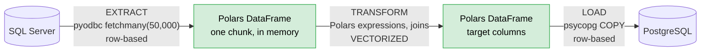
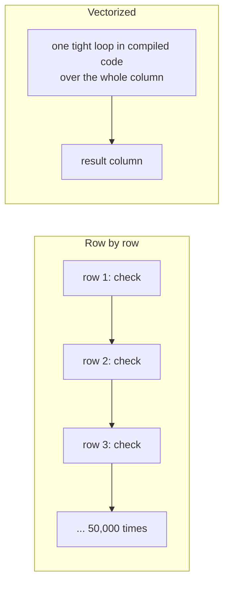
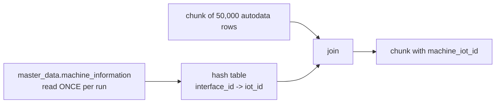
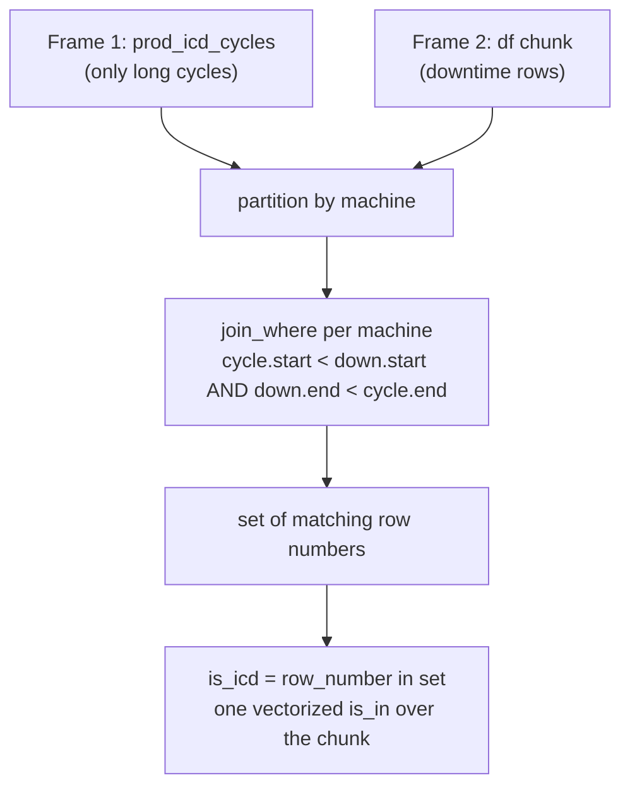

# Why Polars makes this migration fast

This file explains **why the transform step is fast** and which parts of the pipeline are *not* Polars.
For what the pipeline does, see [README.md](README.md).

*Diagrams are Mermaid. They show on GitHub and in the VS Code markdown preview.*

---

## 1. The short answer

> The old way did the work **one row at a time**. Polars does it **one column at a time, for thousands of rows at once**,
> in memory, on several CPU cores, in compiled code.

| | Row by row (old SQL check, plain Python loop) | Polars (this pipeline) |
|---|---|---|
| Unit of work | 1 row | a whole column of a chunk (up to 50,000 rows) |
| Where it runs | the database engine, or the Python interpreter | compiled Rust code, no Python in the inner loop |
| Data layout | row by row | column by column (columnar) |
| Cores used | usually 1 | all available |
| Repeated work | the check runs again for every row | joins and group-bys build a lookup structure once |

---

## 2. Where Polars is used in this pipeline



The green boxes are where Polars does the work. The two arrows into and out of the database are **not** Polars:
the database driver hands rows over, and they are copied out again. This is explained honestly in section 8.

---

## 3. Idea 1: vectorized execution

**Vectorized** means: one operation is applied to a *whole column* in one call, not to one value per call.

Row by row (what we do **not** do):

```python
for row in rows:                       # 50,000 times, each time the Python interpreter runs
    if row["mc"].lower().strip() == ...:
        ...
```

Polars expression (what the pipeline does, for example in `transform.py` and `add_is_icd`):

```python
key = pl.col("mc").str.to_lowercase().str.strip_chars_end()     # described once ...
batch.with_columns(key.alias("_mc"))                             # ... applied to ALL rows in one call
```

What happens inside:



Why this is faster:

* **No interpreter overhead per row.** A Python loop pays a cost on every iteration (type checks, function calls).
  Polars pays it once per column, then runs a compiled loop.
* **CPU-friendly.** The loop runs over a plain array of numbers, so the CPU can use *SIMD* (one instruction on
  several values at once) and keep the data in its fast cache.

---

## 4. Idea 2: columnar, in-memory data

Polars stores data **by column** (the Apache Arrow layout), not by row.

```
Row layout:     [mc, sttime, ndtime] [mc, sttime, ndtime] [mc, sttime, ndtime] ...
Column layout:  mc:     [M1, M1, M2, ...]
                sttime: [06:00, 06:10, 06:12, ...]      <- one filter or compare reads only this block
                ndtime: [06:05, 06:12, 06:30, ...]
```

* A rule like `sttime < ndtime` reads **only the two columns it needs**. The other columns are not touched.
* Values of one type sit next to each other, so memory is read in long straight runs. This is what the CPU is best at.
* Each chunk is held **in memory** while it is transformed. No temporary table in the database, no file on disk.
  The pipeline's `extract` also asks SQL Server only for the columns the mapping uses, so less data is moved.

**Memory stays bounded.** The pipeline never loads the whole 900,000-row table at once. It reads
**50,000 rows at a time** (`fetchmany(50000)`), transforms the chunk, loads it, then moves on. The window's
cycle frame (`prod_icd_cycles`) is the only thing kept for the whole window, and it holds just three columns
of the long cycles.

---

## 5. Idea 3: many cores, no Python lock

Python normally runs one thread at a time (the GIL). Polars runs in Rust and **releases that lock**, so a single
call like a join or a `group_by` can use all CPU cores by splitting the work into parts.

You do not have to write any threading code. The same expression runs faster on a bigger machine.

---

## 6. Idea 4: joins instead of per-row lookups

Two places in the pipeline would be slow row by row and are fast as one join.

### 6.1 Lookups (`machine_iot_id`, `component_iot_id`, ...)

Each `autodata` row carries interface ids (for example the machine code). The target needs the `iot_id`.

* **Row by row:** one database query per row = 900,000 round trips.
* **Here:** each master table is read **once per run** into a DataFrame (`lookup_source: load: once_per_run`),
  then **joined** to every chunk. A join builds a hash table of the small side once and probes it for every row.



### 6.2 `is_icd` (in-cycle downtime)

The old SQL ran a check for **every** downtime row: "is there a cycle of the same machine that contains me?"
(an `EXISTS` sub-query per row). The code comment in the pipeline notes this took minutes per window.

`add_is_icd` in `pipeline/extract.py` does it set-wise instead:

1. Split the chunk's downtime rows and the cycles **by machine** (`partition_by`), so a join only compares rows of one machine.
2. Join them with the three range conditions (`join_where`: cycle starts before, ends after, and is within lookback).
3. Collect the matching row numbers and mark them in **one** `is_in` operation (a hash-set test), cast to 1 / 0.



Another speed-up here is **doing less work**: the cycles are first filtered to the time range of the chunk's downtimes
before joining, and Frame 1 only holds cycles that can contain a downtime at all (`duration > cycletime`).

---

## 7. Idea 5: one global frame instead of a second pass (`autodata_maxtime`)

Finding "the latest row of each machine" could mean reading 900,000 rows again, or a huge `GROUP BY` in the database.
The pipeline instead **folds each chunk into one small global DataFrame** (`pipeline/maxtime.py`) while the data is
already in memory:

* the frame never has more than **one row per machine** (about 158 rows),
* each update is a sort and `unique(subset=machine)` on a tiny frame plus the chunk's own latest rows.

So the extra work is almost free, and no extra read from either database is needed.

---

## 8. The honest part: what Polars does **not** speed up

Being clear about this is important, because it is the first question a good engineer will ask.

| Step | Mostly limited by | Is it Polars? |
|---|---|---|
| Extract | network and SQL Server returning rows through ODBC (`pyodbc`, row tuples converted into a DataFrame) | No |
| **Transform** | CPU and memory | **Yes, vectorized** |
| Load | PostgreSQL `COPY` fed from Python (`copy_dataframe` writes rows one by one into the COPY stream) | No |

* Polars removes the **slow, CPU-heavy middle**: casts, trims, lookups, duplicate checks and `is_icd`. Before, `is_icd`
  alone took minutes per window.
* The first full real run read and loaded **913,753 `autodata` rows in about 2.5 minutes end to end** (extract + transform +
  load, 4 windows). That is a whole-pipeline number. Do not quote it as "Polars speed".
* If the total time needs to drop further, the next places to look are the database read and the `COPY` loop,
  not the transform.

---

## 9. Eager mode (what this pipeline uses)

Polars can run **eagerly** (each line runs right away, as here) or **lazily** (`scan_*` / `.lazy()` builds a plan,
and an optimizer reorders it before running, for example reading only the needed columns and pushing filters down).

This pipeline uses eager DataFrames on 50,000-row chunks, because the data arrives from a database cursor, not from a file.
Lazy mode would help mostly when scanning large files.

---

## 10. Summary for a talk

* **Vectorized:** one call works on a whole column. No per-row Python loop.
* **Columnar and in memory:** only the needed columns are touched, and the chunk never leaves RAM until it is loaded.
* **Parallel:** joins and group-bys use all cores, without threading code.
* **Joins, not lookups per row:** master tables are read once; `is_icd` is a join per machine, not a sub-query per row.
* **Bounded memory:** 50,000 rows at a time, plus one small frame per window and one row per machine for `autodata_maxtime`.
* **Honest limit:** the database read and the `COPY` write are row-based. Polars speeds up the transform in the middle.
